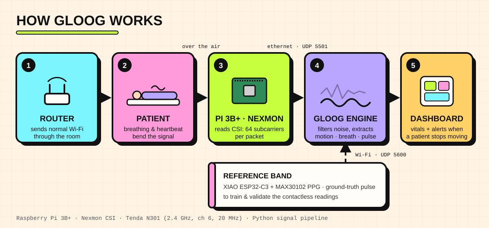
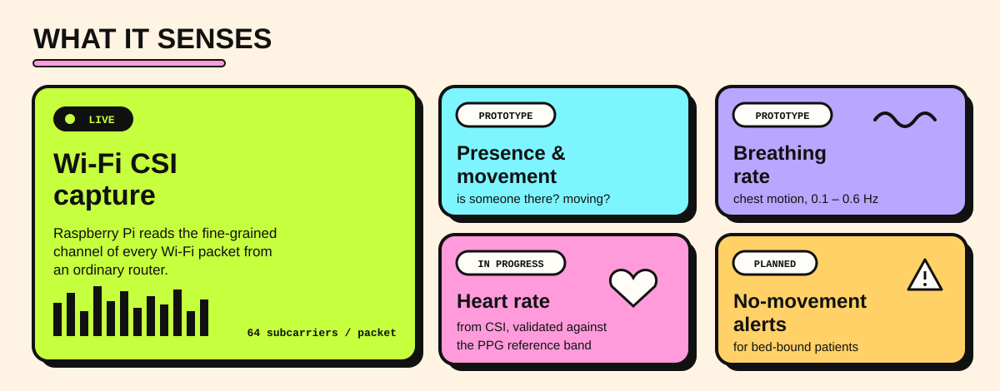

<p align="center">
  
</p>

<p align="center">
  
  
  
  
</p>

<h3 align="center">No camera. Nothing to wear. Just the Wi-Fi already in the room.</h3>

<br>

## ✦ The problem

Patients who spend their days in bed, in wards, ICUs and elder care, need someone watching their breathing and movement around the clock. Today that means one of three things:

- **Wearables** that get pulled off, irritate skin and need charging.
- **Cameras** that patients and families don't want in a bedroom.
- **A nurse checking in**, which doesn't scale to every bed, every hour.

## ✦ The idea

Every Wi-Fi packet carries **Channel State Information (CSI)**: a fingerprint of how the signal bent, bounced and faded on its way across the room. A rising chest and a beating heart change that fingerprint in tiny, rhythmic ways.

**Gloog reads those changes.** An ordinary router talks, a Raspberry Pi listens, and our signal engine turns the ripples into presence, movement, breathing and heart rate. The patient doesn't wear or charge anything, and no images are ever captured.

<br>

<p align="center">
  
</p>

<br>

<p align="center">
  
</p>

<br>

## ✦ Why Gloog

| | Wearables | Cameras | **Gloog** |
|---|:---:|:---:|:---:|
| Nothing on the patient's body | ✗ | ✓ | **✓** |
| No images of the patient | ✓ | ✗ | **✓** |
| Works in the dark | ✓ | needs IR | **✓** |
| No charging, nothing to forget | ✗ | ✓ | **✓** |
| Uses hardware that's already in the room | ✗ | ✗ | **✓** |

## ✦ Hardware

| Part | Role |
|---|---|
| **Raspberry Pi 3B+** with [Nexmon CSI](https://github.com/seemoo-lab/nexmon_csi) | The sensor: reads CSI from every Wi-Fi frame the router sends |
| **Tenda N301 router** (2.4 GHz, ch 6, 20 MHz) | The Wi-Fi source. Portable, needs power only, no internet |
| **Seeed XIAO ESP32-C3 + MAX30102** | Reference band: ground-truth pulse for training and validation |
| **Arduino + servo phantom** | Mechanical "chest" that breathes at a set rate, for repeatable tests |

## ✦ Repo map

```
gloog/
├── firmware/
│   ├── pi/                 CSI capture + forwarding (Raspberry Pi)
│   ├── band/               reference band, phone Wi-Fi setup, auto-finds the laptop
│   ├── phantom/            servo breathing phantom
│   └── tests/              Wi-Fi, I2C and traffic test sketches
├── signal-processing/      receiver: live presence, breathing, heart rate + CSV logs
├── backend/                API (coming)
├── frontend/               dashboard (coming)
└── docs/                   bring-up guide + design assets
```

## ✦ Quick start

```bash
# Raspberry Pi (after every boot)
cd ~/gloog/firmware/pi && sudo ./start_csi.sh

# Laptop
cd signal-processing && pip install numpy scipy && python receiver.py
```

Band: power it on, join the **`Gloog-Band-Setup`** hotspot from your phone, pick the Wi-Fi. It finds the laptop by itself.

Full step-by-step setup, from a blank SD card: **[docs/README.md](docs/README.md)**

## ✦ Roadmap

| | Milestone |
|:---:|---|
| ✅ | CSI capture on Raspberry Pi 3B+ with Nexmon |
| 🔧 | Live Pi → laptop CSI pipeline with on-the-fly vitals |
| 🔧 | Reference band with phone Wi-Fi setup and laptop auto-discovery |
| ⏳ | Breathing and presence validated on the servo phantom |
| ⏳ | Heart rate from CSI, benchmarked against the reference band |
| ⏳ | No-movement alerts and live dashboard |
| ⏳ | Research publication |

<br>

> [!NOTE]
> Gloog is a research prototype. It is not a medical device and is not intended for diagnosis or treatment.

<br>

<p align="center">
  <b>Built by <a href="mailto:genzis.hq@gmail.com">Genzis</a></b><br>
  <sub>Generations Ahead.</sub>
</p>
